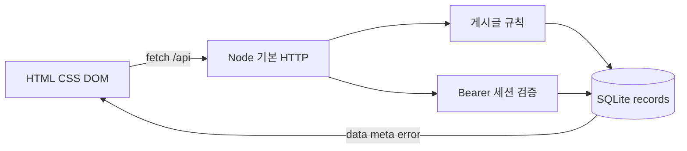

# studyMidpoint · HTML·CSS·JavaScript — 중간 응용: 기초 게시판

## ① 목표 한 줄

study0~10의 지식만으로 회원가입·로그인·게시글 CRUD가 있는 서비스를 실행한다.

## ② 📖 이론

이 프로젝트는 함수·ESM·상태·DOM·hash 라우팅·폼·fetch·SQLite·인증만 사용한다. 심화 UI 저장소, 외부 DB 드라이버, 결제, AI, WebSocket은 사용하지 않는다. midpoint/app.js는 단순 변수와 함수로 화면을 만들고 server/basic.js는 Node 기본 HTTP로 요청을 분기한다.

기능 목록은 회원가입·로그인·로그아웃, 공개 글 목록·검색·페이지 이동·상세, 인증된 작성, 작성자 수정·삭제다. 서버는 공통 v1 댓글 경로도 제공한다. 별도 정적 Todo는 기초 로컬 상태 복습용으로 유지한다.

폴더는 midpoint/(화면), server/basic.js(라우트), auth.js(인증), validation.js(검증), board.js(규칙), sqlite.js(저장), errors.js(응답), static.js(파일 전달)다. UI가 서버 세부 저장 구조를 모르도록 API 계약을 경계로 둔다.

### 비유로 이해하기

기초에서 만든 부품으로 작은 가게를 열고 주문·직원 출입·장부 저장이 함께 맞는지 확인하는 단계다.

## ③ 🛠️ 실기: 전체 코드와 줄별 설명

1. 목표와 기능 목록을 읽고 페이지의 입력·출력 영역부터 작성한다.
2. SQLite 저장소 → 도메인 board → 인증 auth → HTTP 라우트 순으로 구현한다.
3. 계정 폼 → 목록 → 상세 → 작성 → 수정 → 삭제 순서로 UI를 연결한다.
4. 실행 중인 심화 서버를 종료하고 npm run midpoint로 기초 서버를 켠다. /midpoint/에 접속한다.
5. 서로 다른 계정으로 작성자 권한을 확인하고 npm test로 공통 모듈도 검사한다.
6. 1차 배포 전 환경·파일 공개·DB 영속성·HTTPS를 점검하고 회고를 쓴다.

### DB·API 연동 구성도



### 1차 배포 체크리스트

- [ ] Node 버전과 npm ci 결과를 기록했다.
- [ ] 별도 SQLITE_PATH에 쓰기 권한·영속 디스크가 있다.
- [ ] /health와 계정·게시글 API가 동작한다.
- [ ] 남의 글 수정 403·로그아웃 후 401을 확인했다.
- [ ] HTTPS·동일 출처·.env 비공개를 점검했다.
- [ ] 운영 전 로그인 rate limit과 공유 세션 정책을 심화 서버 수준으로 보강한다.

### 회고

1. 직접 만든 기능과 실행 결과를 적는다.
2. 증상→원인→해결을 요청 경계별로 정리한다.
3. localStorage Todo와 서버 DB 게시글의 저장 수명을 설명한다.
4. 다음 확장 전에 유지할 API 계약을 적는다. 학습자 자신의 수행 여부는 직접 체크한다.


### 단계별 실행 위치

`npm run dev` 후 `/lessons/studyMidpoint/`에서 이 단계의 실습을 연다. [실습 HTML](lessons/studyMidpoint/index.html)과 [전체 실습 목차](lessons/index.html)를 사용한다. 기초 중간 프로젝트 전체 화면은 `npm run midpoint` 후 `/midpoint/`에서 실행한다. 터미널 전용 DB·Docker·MCP 명령은 해당 문서의 실행 순서를 따른다.

### `midpoint/index.html` 전체 코드

```html
<!doctype html>
<html lang="ko">
<head><meta charset="utf-8"><meta name="viewport" content="width=device-width, initial-scale=1"><title>중간 응용 게시판</title><link rel="stylesheet" href="/workbook/style.css"></head>
<body><main class="container">
  <h1>study0~10 중간 응용</h1><p id="message" role="status"></p>
  <section><h2>계정</h2><form id="account"><label for="email">이메일</label><input id="email" name="email" type="email" required><label for="password">비밀번호</label><input id="password" name="password" type="password" minlength="12" maxlength="128" required><label for="nickname">별명</label><input id="nickname" name="nickname" maxlength="40"><button value="signup">회원가입</button><button value="login">로그인</button></form><button id="logout">로그아웃</button></section>
  <section><h2>게시글 목록</h2><form id="search"><label for="q">검색</label><input id="q" name="q"><button>검색</button></form><ul id="list"></ul><button id="previous">이전</button><span id="page"></span><button id="next">다음</button></section>
  <section><h2>글 작성·수정</h2><form id="editor"><label for="title">제목</label><input id="title" name="title" required maxlength="200"><label for="body">내용</label><textarea id="body" name="body" required maxlength="10000"></textarea><button>저장</button><button id="cancel" type="button">수정 취소</button></form></section>
  <section><h2>글 상세</h2><pre id="detail"></pre><button id="edit">선택 글 수정</button><button id="delete">선택 글 삭제</button></section>
</main><script type="module" src="app.js"></script></body>
</html>
```

원본: [midpoint/index.html](midpoint/index.html) · SHA-256(LF 정규화): `f9213e58d6ed561712a7de3f343a4ec880bdfde3b2573b0c71f15749a98b36e0`

줄 번호는 위 코드의 첫 줄을 1로 센다. 빈 줄은 설명에서 생략한다.

| 줄 | 설명 |
|---|---|
| 1 | HTML 표준 모드로 문서를 해석하도록 선언한다. |
| 2 | 문서 언어/루트를 정의한다. |
| 3 | 메타정보 / 문자 인코딩·화면 배율·설명 / 브라우저 탭 제목 / 공통 CSS 연결를 정의한다. |
| 4 | body 요소 / 본문를 정의한다. |
| 5 | 최상위 제목 / 설명·상태 메시지를 정의한다. |
| 6 | 주제 구역 / 구역 제목 / 입력 제출 단위 / 입력의 접근 가능한 이름 / 사용자 입력 / 키보드 가능한 동작를 정의한다. |
| 7 | 주제 구역 / 구역 제목 / 입력 제출 단위 / 입력의 접근 가능한 이름 / 사용자 입력 / 키보드 가능한 동작 / ul 요소 / span 요소를 정의한다. |
| 8 | 주제 구역 / 구역 제목 / 입력 제출 단위 / 입력의 접근 가능한 이름 / 사용자 입력 / 여러 줄 입력 / 키보드 가능한 동작를 정의한다. |
| 9 | 주제 구역 / 구역 제목 / 줄바꿈을 보존한 텍스트 출력 / 키보드 가능한 동작를 정의한다. |
| 10 | ESM 진입점 연결를 정의한다. |
| 11 | 현재 HTML 요소를 닫는다. |


### `midpoint/app.js` 전체 코드

```javascript
// 배열/객체·함수·DOM·fetch·폼·해시 라우팅만으로 만든 기초 프로젝트다.
const $ = id => document.getElementById(id);
let token = '', selected = null, editing = null, page = 1, q = '';
const show = text => { $('message').textContent = text; };
async function api(path, method = 'GET', value) {
  const response = await fetch(`/api${path}`, { method, headers: { 'Content-Type': 'application/json', ...(token ? { Authorization: `Bearer ${token}` } : {}) }, ...(value ? { body: JSON.stringify(value) } : {}) });
  const result = response.status === 204 ? null : await response.json();
  if (!response.ok) throw new Error(result.error.message);
  return result;
}
function form(id, callback) {
  $(id).addEventListener('submit', async event => {
    event.preventDefault();
    if ($(id).dataset.busy) return;
    $(id).dataset.busy = 'true';
    try { await callback(Object.fromEntries(new FormData($(id))), event.submitter?.value); }
    catch (error) { show(error.message); }
    finally { delete $(id).dataset.busy; }
  });
}
async function list() {
  const { data, meta } = await api(`/posts?${new URLSearchParams({ q, page: String(page), limit: '5' })}`);
  $('list').replaceChildren(...data.map(post => {
    const li = document.createElement('li'), link = document.createElement('a');
    link.href = `#/posts/${post.id}`; link.textContent = post.title; li.append(link); return li;
  }));
  $('page').textContent = `${meta.page} / ${Math.max(1, meta.totalPages)}`;
  $('previous').disabled = page <= 1; $('next').disabled = page >= meta.totalPages;
}
async function detail() {
  const match = location.hash.match(/^#\/posts\/(\d+)$/);
  selected = match ? (await api(`/posts/${match[1]}`)).data : null;
  $('detail').textContent = selected ? `${selected.title}\n${selected.body}` : '목록에서 글을 선택하세요.';
}
form('account', async (data, action) => {
  if (action === 'signup') { await api('/auth/signup', 'POST', data); show('가입 완료. 로그인하세요.'); return; }
  const { data: result } = await api('/auth/login', 'POST', { email: data.email, password: data.password });
  token = result.accessToken; $('password').value = ''; show(`${result.user.nickname}님 로그인 중`);
});
form('search', async data => { q = data.q; page = 1; await list(); });
form('editor', async data => { const { data: post } = await api(editing ? `/posts/${editing}` : '/posts', editing ? 'PATCH' : 'POST', data); editing = null; $('editor').reset(); location.hash = `#/posts/${post.id}`; await list(); await detail(); show('저장했습니다.'); });
for (const [id, delta] of [['previous', -1], ['next', 1]]) $(id).onclick = async () => { page += delta; try { await list(); } catch (error) { show(error.message); } };
$('edit').onclick = () => { if (selected) { editing = selected.id; $('title').value = selected.title; $('body').value = selected.body; } };
$('cancel').onclick = () => { editing = null; $('editor').reset(); };
$('delete').onclick = async () => { if (!selected) return; try { await api(`/posts/${selected.id}`, 'DELETE'); selected = null; location.hash = '#/'; await list(); await detail(); show('삭제했습니다.'); } catch (error) { show(error.message); } };
$('logout').onclick = async () => { try { await api('/auth/logout', 'POST'); token = ''; show('로그아웃했습니다.'); } catch (error) { show(error.message); } };
window.addEventListener('hashchange', () => void detail().catch(error => show(error.message)));
await list().catch(error => show(error.message));
await detail().catch(error => show(error.message));
```

원본: [midpoint/app.js](midpoint/app.js) · SHA-256(LF 정규화): `0e88c291728292cf4e8127940bd45fd66bcaad2c1620904a996b4041618355e9`

줄 번호는 위 코드의 첫 줄을 1로 센다. 빈 줄은 설명에서 생략한다.

| 줄 | 설명 |
|---|---|
| 1 | 배열/객체·함수·DOM·fetch·폼·해시 라우팅만으로 만든 기초 프로젝트다. |
| 2 | `$`에 계산값·상태·함수·의존성을 묶어 이후 처리에서 사용한다. |
| 3 | `token`에 계산값·상태·함수·의존성을 묶어 이후 처리에서 사용한다. |
| 4 | 외부 문자열을 HTML로 해석하지 않고 화면의 텍스트로 반영한다. |
| 5 | 이름 있는 처리 함수를 정의하고 인자로 필요한 값을 받는다. |
| 6 | 약속한 URL·메소드·본문으로 요청하고 응답을 기다린다. |
| 7 | 비동기 작업 완료를 기다린 후 다음 단계로 진행한다: const result = response.status === 204 ? null : await response.json(); |
| 8 | 입력·상태·경로 조건을 검사하여 해당 처리만 실행한다: if (!response.ok) throw new Error(result.error.message); |
| 9 | 계산·선택한 결과를 호출한 쪽에 돌려주고 현재 함수를 끝낸다. |
| 10 | 현재 함수·콜백·객체·조건 블록을 닫는다. |
| 11 | 이름 있는 처리 함수를 정의하고 인자로 필요한 값을 받는다. |
| 12 | 사용자/연결 이벤트가 발생할 때 실행할 콜백을 등록한다. |
| 13 | 현재 처리의 설정·호출·상태를 연결한다: `event.preventDefault();` |
| 14 | 입력·상태·경로 조건을 검사하여 해당 처리만 실행한다: if ($(id).dataset.busy) return; |
| 15 | 현재 처리의 설정·호출·상태를 연결한다: `$(id).dataset.busy = 'true';` |
| 16 | 비동기 작업 완료를 기다린 후 다음 단계로 진행한다: try { await callback(Object.fromEntries(new FormData($(id))), event.submitter?.value); } |
| 17 | 실패를 잡아 공통 오류 또는 복구 상태로 바꾼다. |
| 18 | 성공·실패와 관계없이 버튼·연결·자원을 정리한다. |
| 19 | 현재 함수·콜백·객체·조건 블록을 닫는다. |
| 20 | 현재 함수·콜백·객체·조건 블록을 닫는다. |
| 21 | 이름 있는 처리 함수를 정의하고 인자로 필요한 값을 받는다. |
| 22 | 약속한 URL·메소드·본문으로 요청하고 응답을 기다린다. |
| 23 | 데이터로 만든 DOM 요소를 부모에 삽입하거나 기존 화면을 교체한다. |
| 24 | `li`에 계산값·상태·함수·의존성을 묶어 이후 처리에서 사용한다. |
| 25 | 외부 문자열을 HTML로 해석하지 않고 화면의 텍스트로 반영한다. |
| 26 | 현재 함수·콜백·객체·조건 블록을 닫는다. |
| 27 | 외부 문자열을 HTML로 해석하지 않고 화면의 텍스트로 반영한다. |
| 28 | 현재 처리의 설정·호출·상태를 연결한다: `$('previous').disabled = page <= 1; $('next').disabled = page >= meta.totalPages;` |
| 29 | 현재 함수·콜백·객체·조건 블록을 닫는다. |
| 30 | 이름 있는 처리 함수를 정의하고 인자로 필요한 값을 받는다. |
| 31 | `match`에 계산값·상태·함수·의존성을 묶어 이후 처리에서 사용한다. |
| 32 | 약속한 URL·메소드·본문으로 요청하고 응답을 기다린다. |
| 33 | 외부 문자열을 HTML로 해석하지 않고 화면의 텍스트로 반영한다. |
| 34 | 현재 함수·콜백·객체·조건 블록을 닫는다. |
| 35 | 현재 처리의 설정·호출·상태를 연결한다: `form('account', async (data, action) => {` |
| 36 | 약속한 URL·메소드·본문으로 요청하고 응답을 기다린다. |
| 37 | 약속한 URL·메소드·본문으로 요청하고 응답을 기다린다. |
| 38 | 현재 처리의 설정·호출·상태를 연결한다: `token = result.accessToken; $('password').value = ''; show(${result.user.nickname}님 로그인 중);` |
| 39 | 현재 함수·콜백·객체·조건 블록을 닫는다. |
| 40 | 비동기 작업 완료를 기다린 후 다음 단계로 진행한다: form('search', async data => { q = data.q; page = 1; await list(); }); |
| 41 | 약속한 URL·메소드·본문으로 요청하고 응답을 기다린다. |
| 42 | 실패를 잡아 공통 오류 또는 복구 상태로 바꾼다. |
| 43 | 사용자/연결 이벤트가 발생할 때 실행할 콜백을 등록한다. |
| 44 | 사용자/연결 이벤트가 발생할 때 실행할 콜백을 등록한다. |
| 45 | 실패를 잡아 공통 오류 또는 복구 상태로 바꾼다. |
| 46 | 실패를 잡아 공통 오류 또는 복구 상태로 바꾼다. |
| 47 | 사용자/연결 이벤트가 발생할 때 실행할 콜백을 등록한다. |
| 48 | 비동기 작업 완료를 기다린 후 다음 단계로 진행한다: await list().catch(error => show(error.message)); |
| 49 | 비동기 작업 완료를 기다린 후 다음 단계로 진행한다: await detail().catch(error => show(error.message)); |


### `server/basic.js` 전체 코드

```javascript
import { createServer } from 'node:http';
import { randomUUID } from 'node:crypto';
import { pathToFileURL } from 'node:url';
import { createSQLite } from './sqlite.js';
import { createBoard } from './board.js';
import { createAuth, publicUser, hashPassword, verifyPassword } from './auth.js';
import { validate, signupSchema, loginSchema, postSchema, patchSchema, commentSchema, numericId } from './validation.js';
import { send, sendError, fail, readJson } from './errors.js';
import { serveStatic } from './static.js';

// study0~10만 사용하는 중간 프로젝트 서버다. 외부 서비스/AI/웹소켓은 없다.
export function createBasicApp(repo, origin = 'http://localhost:3000') {
  const auth = createAuth(repo), board = createBoard(repo);
  let queue = Promise.resolve();
  const current = async req => (await auth.require(req)).user;
  const server = createServer((req, res) => {
    const requestId = randomUUID();
    res.setHeader('X-Request-Id', requestId);
    res.setHeader('Cache-Control', 'no-store');
    res.setHeader('X-Content-Type-Options', 'nosniff');
    res.setHeader('Content-Security-Policy', "default-src 'self'; script-src 'self'; style-src 'self'; frame-ancestors 'none'; base-uri 'none'");
    const run = async () => {
      try {
        if (req.headers.origin && req.headers.origin !== origin) fail(403, 'FORBIDDEN', '동일 출처만 허용합니다.');
        const { pathname: path, searchParams } = new URL(req.url, origin);
        const method = req.method;
        if (path === '/health' && method === 'GET') return send(res, 200, { status: 'ok' });
        if (path === '/' && method === 'GET') { res.writeHead(302, { Location: '/midpoint/' }); return res.end(); }
        if (['/api/auth/signup', '/api/auth/login'].includes(path) && method === 'POST') {
          const signup = path.endsWith('signup');
          const input = validate(signup ? signupSchema : loginSchema, await readJson(req));
          let user = (await repo.list('users')).find(u => u.email === input.email);
          if (signup) {
            if (user) fail(409, 'EMAIL_TAKEN', '이미 가입한 이메일입니다.');
            user = await repo.create('users', { email: input.email, nickname: input.nickname, passwordHash: await hashPassword(input.password) });
            return send(res, 201, { data: publicUser(user) });
          }
          if (!user || !await verifyPassword(input.password, user.passwordHash)) fail(401, 'INVALID_CREDENTIALS', '로그인 정보를 확인하세요.');
          return send(res, 200, { data: await auth.issue(user) });
        }
        if (path === '/api/auth/me' && method === 'GET') return send(res, 200, { data: publicUser(await current(req)) });
        if (path === '/api/auth/logout' && method === 'POST') { const { session } = await auth.require(req); await repo.delete('sessions', session.id); return send(res, 204); }
        if (path === '/api/posts' && method === 'GET') return send(res, 200, await board.list(searchParams));
        if (path === '/api/posts' && method === 'POST') {
          const user = await current(req);
          const data = await board.create(validate(postSchema, await readJson(req)), user);
          return send(res, 201, { data }, { Location: `/api/posts/${data.id}` });
        }
        const match = path.match(/^\/api\/posts\/([^/]+)$/);
        if (match) {
          const id = numericId(match[1]);
          if (method === 'GET') return send(res, 200, { data: await board.get(id) });
          if (method === 'PATCH') return send(res, 200, { data: await board.patch(id, validate(patchSchema, await readJson(req)), await current(req)) });
          if (method === 'DELETE') { await board.delete(id, await current(req)); return send(res, 204); }
        }
        const comments = path.match(/^\/api\/posts\/([^/]+)\/comments$/);
        if (comments && method === 'GET') return send(res, 200, { data: await board.comments(numericId(comments[1])) });
        if (comments && method === 'POST') return send(res, 201, { data: await board.comment(numericId(comments[1]), validate(commentSchema, await readJson(req)), await current(req)) });
        const comment = path.match(/^\/api\/comments\/([^/]+)$/);
        if (comment && method === 'DELETE') { await board.deleteComment(numericId(comment[1]), await current(req)); return send(res, 204); }
        if (method === 'GET' && !path.startsWith('/api/')) return serveStatic(req, res, path);
        fail(404, 'NOT_FOUND', '경로가 없습니다.');
      } catch (error) { sendError(res, error, requestId); }
    };
    if (['POST', 'PATCH', 'DELETE'].includes(req.method)) queue = queue.then(run, run);
    else void run();
  });
  return { server, close: async () => { await new Promise(resolve => { server.close(resolve); server.closeAllConnections(); }); await queue; await repo.close(); } };
}
if (process.argv[1] && import.meta.url === pathToFileURL(process.argv[1]).href) {
  const app = createBasicApp(createSQLite(process.env.SQLITE_PATH || 'data/midpoint.sqlite'), process.env.PUBLIC_ORIGIN);
  app.server.listen(Number(process.env.PORT || 3000), process.env.HOST || '127.0.0.1', () => console.log('중간 실습: http://localhost:3000/midpoint/'));
  process.once('SIGINT', () => void app.close());
}
```

원본: [server/basic.js](server/basic.js) · SHA-256(LF 정규화): `71acc9e0df0af65a3562316418ed8e4897a34ea437fae9e366e7d925b7c3c939`

줄 번호는 위 코드의 첫 줄을 1로 센다. 빈 줄은 설명에서 생략한다.

| 줄 | 설명 |
|---|---|
| 1 | 필요한 함수·클래스만 모듈에서 가져와 이 파일의 의존성을 선언한다. |
| 2 | 필요한 함수·클래스만 모듈에서 가져와 이 파일의 의존성을 선언한다. |
| 3 | 필요한 함수·클래스만 모듈에서 가져와 이 파일의 의존성을 선언한다. |
| 4 | 필요한 함수·클래스만 모듈에서 가져와 이 파일의 의존성을 선언한다. |
| 5 | 필요한 함수·클래스만 모듈에서 가져와 이 파일의 의존성을 선언한다. |
| 6 | 필요한 함수·클래스만 모듈에서 가져와 이 파일의 의존성을 선언한다. |
| 7 | 필요한 함수·클래스만 모듈에서 가져와 이 파일의 의존성을 선언한다. |
| 8 | 필요한 함수·클래스만 모듈에서 가져와 이 파일의 의존성을 선언한다. |
| 9 | 필요한 함수·클래스만 모듈에서 가져와 이 파일의 의존성을 선언한다. |
| 11 | study0~10만 사용하는 중간 프로젝트 서버다. 외부 서비스/AI/웹소켓은 없다. |
| 12 | 다른 모듈이 사용할 인터페이스를 공개한다. 이름 있는 처리 함수를 정의하고 인자로 필요한 값을 받는다. |
| 13 | `auth`에 계산값·상태·함수·의존성을 묶어 이후 처리에서 사용한다. |
| 14 | `queue`에 계산값·상태·함수·의존성을 묶어 이후 처리에서 사용한다. |
| 15 | 비동기 작업 완료를 기다린 후 다음 단계로 진행한다: const current = async req => (await auth.require(req)).user; |
| 16 | `server`에 계산값·상태·함수·의존성을 묶어 이후 처리에서 사용한다. |
| 17 | `requestId`에 계산값·상태·함수·의존성을 묶어 이후 처리에서 사용한다. |
| 18 | 현재 처리의 설정·호출·상태를 연결한다: `res.setHeader('X-Request-Id', requestId);` |
| 19 | 현재 처리의 설정·호출·상태를 연결한다: `res.setHeader('Cache-Control', 'no-store');` |
| 20 | 현재 처리의 설정·호출·상태를 연결한다: `res.setHeader('X-Content-Type-Options', 'nosniff');` |
| 21 | 현재 처리의 설정·호출·상태를 연결한다: `res.setHeader('Content-Security-Policy', "default-src 'self'; script-src 'self'; style-src 'self'; frame-ancestors 'none` |
| 22 | `run`에 계산값·상태·함수·의존성을 묶어 이후 처리에서 사용한다. |
| 23 | 현재 처리의 설정·호출·상태를 연결한다: `try {` |
| 24 | 조건을 만족하지 않는 요청을 지정 HTTP 상태와 오류 코드로 거절한다. |
| 25 | `{ pathname: path, searchParams }`에 계산값·상태·함수·의존성을 묶어 이후 처리에서 사용한다. |
| 26 | `method`에 계산값·상태·함수·의존성을 묶어 이후 처리에서 사용한다. |
| 27 | HTTP 상태·헤더·data/error 본문을 구성해 클라이언트에 응답한다. |
| 28 | HTTP 상태·헤더·data/error 본문을 구성해 클라이언트에 응답한다. |
| 29 | 입력·상태·경로 조건을 검사하여 해당 처리만 실행한다: if (['/api/auth/signup', '/api/auth/login'].includes(path) && method === 'POST') { |
| 30 | `signup`에 계산값·상태·함수·의존성을 묶어 이후 처리에서 사용한다. |
| 31 | 비동기 작업 완료를 기다린 후 다음 단계로 진행한다: const input = validate(signup ? signupSchema : loginSchema, await readJson(req)); |
| 32 | 공통 저장소 계약을 통해 도메인 자료를 읽거나 변경하고 후속 처리로 연결한다. |
| 33 | 입력·상태·경로 조건을 검사하여 해당 처리만 실행한다: if (signup) { |
| 34 | 조건을 만족하지 않는 요청을 지정 HTTP 상태와 오류 코드로 거절한다. |
| 35 | 공통 저장소 계약을 통해 도메인 자료를 읽거나 변경하고 후속 처리로 연결한다. |
| 36 | HTTP 상태·헤더·data/error 본문을 구성해 클라이언트에 응답한다. |
| 37 | 현재 함수·콜백·객체·조건 블록을 닫는다. |
| 38 | 조건을 만족하지 않는 요청을 지정 HTTP 상태와 오류 코드로 거절한다. |
| 39 | HTTP 상태·헤더·data/error 본문을 구성해 클라이언트에 응답한다. |
| 40 | 현재 함수·콜백·객체·조건 블록을 닫는다. |
| 41 | HTTP 상태·헤더·data/error 본문을 구성해 클라이언트에 응답한다. |
| 42 | HTTP 상태·헤더·data/error 본문을 구성해 클라이언트에 응답한다. |
| 43 | HTTP 상태·헤더·data/error 본문을 구성해 클라이언트에 응답한다. |
| 44 | 입력·상태·경로 조건을 검사하여 해당 처리만 실행한다: if (path === '/api/posts' && method === 'POST') { |
| 45 | 비동기 작업 완료를 기다린 후 다음 단계로 진행한다: const user = await current(req); |
| 46 | 비동기 작업 완료를 기다린 후 다음 단계로 진행한다: const data = await board.create(validate(postSchema, await readJson(req)), user); |
| 47 | HTTP 상태·헤더·data/error 본문을 구성해 클라이언트에 응답한다. |
| 48 | 현재 함수·콜백·객체·조건 블록을 닫는다. |
| 49 | `match`에 계산값·상태·함수·의존성을 묶어 이후 처리에서 사용한다. |
| 50 | 입력·상태·경로 조건을 검사하여 해당 처리만 실행한다: if (match) { |
| 51 | `id`에 계산값·상태·함수·의존성을 묶어 이후 처리에서 사용한다. |
| 52 | HTTP 상태·헤더·data/error 본문을 구성해 클라이언트에 응답한다. |
| 53 | HTTP 상태·헤더·data/error 본문을 구성해 클라이언트에 응답한다. |
| 54 | HTTP 상태·헤더·data/error 본문을 구성해 클라이언트에 응답한다. |
| 55 | 현재 함수·콜백·객체·조건 블록을 닫는다. |
| 56 | `comments`에 계산값·상태·함수·의존성을 묶어 이후 처리에서 사용한다. |
| 57 | HTTP 상태·헤더·data/error 본문을 구성해 클라이언트에 응답한다. |
| 58 | HTTP 상태·헤더·data/error 본문을 구성해 클라이언트에 응답한다. |
| 59 | `comment`에 계산값·상태·함수·의존성을 묶어 이후 처리에서 사용한다. |
| 60 | HTTP 상태·헤더·data/error 본문을 구성해 클라이언트에 응답한다. |
| 61 | 입력·상태·경로 조건을 검사하여 해당 처리만 실행한다: if (method === 'GET' && !path.startsWith('/api/')) return serveStatic(req, res, path); |
| 62 | 조건을 만족하지 않는 요청을 지정 HTTP 상태와 오류 코드로 거절한다. |
| 63 | 실패를 잡아 공통 오류 또는 복구 상태로 바꾼다. |
| 64 | 현재 함수·콜백·객체·조건 블록을 닫는다. |
| 65 | 입력·상태·경로 조건을 검사하여 해당 처리만 실행한다: if (['POST', 'PATCH', 'DELETE'].includes(req.method)) queue = queue.then(run, run); |
| 66 | 현재 처리의 설정·호출·상태를 연결한다: `else void run();` |
| 67 | 현재 함수·콜백·객체·조건 블록을 닫는다. |
| 68 | 공통 저장소 계약을 통해 도메인 자료를 읽거나 변경하고 후속 처리로 연결한다. |
| 69 | 현재 함수·콜백·객체·조건 블록을 닫는다. |
| 70 | 입력·상태·경로 조건을 검사하여 해당 처리만 실행한다: if (process.argv[1] && import.meta.url === pathToFileURL(process.argv[1]).href) { |
| 71 | `app`에 계산값·상태·함수·의존성을 묶어 이후 처리에서 사용한다. |
| 72 | 개발·운영에서 관찰할 실행 결과를 콘솔에 남긴다. |
| 73 | 현재 처리의 설정·호출·상태를 연결한다: `process.once('SIGINT', () => void app.close());` |
| 74 | 현재 함수·콜백·객체·조건 블록을 닫는다. |


### `server/sqlite.js` 전체 코드

```javascript
import { DatabaseSync } from 'node:sqlite';
import { mkdirSync } from 'node:fs';
import { dirname } from 'node:path';

// 기초 구간에서 사용할 SQLite 전용 저장소다. 심화 드라이버를 불러오지 않는다.
export function createSQLite(path = 'data/study.sqlite') {
  if (path !== ':memory:') mkdirSync(dirname(path), { recursive: true });
  const db = new DatabaseSync(path);
  db.exec('PRAGMA journal_mode=WAL; CREATE TABLE IF NOT EXISTS records (id INTEGER PRIMARY KEY AUTOINCREMENT, kind TEXT NOT NULL, payload TEXT NOT NULL); CREATE INDEX IF NOT EXISTS records_kind ON records(kind);');
  const repo = {
    list: async kind => db.prepare('SELECT id,payload FROM records WHERE kind=?').all(kind).map(row => ({ ...JSON.parse(row.payload), id: Number(row.id) })),
    get: async (kind, id) => (await repo.list(kind)).find(row => row.id === id),
    create: async (kind, value) => ({ ...value, id: Number(db.prepare('INSERT INTO records(kind,payload) VALUES(?,?)').run(kind, JSON.stringify(value)).lastInsertRowid) }),
    put: async (kind, id, value) => { db.prepare('UPDATE records SET payload=? WHERE kind=? AND id=?').run(JSON.stringify(value), kind, id); return { ...value, id }; },
    delete: async (kind, id) => db.prepare('DELETE FROM records WHERE kind=? AND id=?').run(kind, id),
    close: async () => db.close(),
  };
  return repo;
}
```

원본: [server/sqlite.js](server/sqlite.js) · SHA-256(LF 정규화): `26b625a25b0e90fa67b41daaed24b2e75ec2775e83da80c590a5b3f23469f82c`

줄 번호는 위 코드의 첫 줄을 1로 센다. 빈 줄은 설명에서 생략한다.

| 줄 | 설명 |
|---|---|
| 1 | 필요한 함수·클래스만 모듈에서 가져와 이 파일의 의존성을 선언한다. |
| 2 | 필요한 함수·클래스만 모듈에서 가져와 이 파일의 의존성을 선언한다. |
| 3 | 필요한 함수·클래스만 모듈에서 가져와 이 파일의 의존성을 선언한다. |
| 5 | 기초 구간에서 사용할 SQLite 전용 저장소다. 심화 드라이버를 불러오지 않는다. |
| 6 | 다른 모듈이 사용할 인터페이스를 공개한다. 이름 있는 처리 함수를 정의하고 인자로 필요한 값을 받는다. |
| 7 | 입력·상태·경로 조건을 검사하여 해당 처리만 실행한다: if (path !== ':memory:') mkdirSync(dirname(path), { recursive: true }); |
| 8 | `db`에 계산값·상태·함수·의존성을 묶어 이후 처리에서 사용한다. |
| 9 | 선택한 DB 드라이버로 스키마·매개변수 질의·연결 수명을 처리한다. |
| 10 | `repo`에 계산값·상태·함수·의존성을 묶어 이후 처리에서 사용한다. |
| 11 | 직렬화된 문자열을 객체로 복구한다. 잘못된 형식은 예외 경로로 보낸다. |
| 12 | 공통 저장소 계약을 통해 도메인 자료를 읽거나 변경하고 후속 처리로 연결한다. |
| 13 | 객체를 JSON 문자열로 바꿔 저장·전송·관찰한다. |
| 14 | 객체를 JSON 문자열로 바꿔 저장·전송·관찰한다. |
| 15 | 선택한 DB 드라이버로 스키마·매개변수 질의·연결 수명을 처리한다. |
| 16 | 선택한 DB 드라이버로 스키마·매개변수 질의·연결 수명을 처리한다. |
| 17 | 현재 함수·콜백·객체·조건 블록을 닫는다. |
| 18 | 계산·선택한 결과를 호출한 쪽에 돌려주고 현재 함수를 끝낸다. |
| 19 | 현재 함수·콜백·객체·조건 블록을 닫는다. |


### `server/auth.js` 전체 코드

```javascript
import { randomBytes, scrypt as scryptCallback, timingSafeEqual, createHash } from 'node:crypto';
import { promisify } from 'node:util';
import { fail } from './errors.js';

const scrypt = promisify(scryptCallback);
const digest = value => createHash('sha256').update(value).digest('hex');
export const publicUser = user => ({ id: user.id, email: user.email, nickname: user.nickname });
export async function hashPassword(password) {
  const salt = randomBytes(16).toString('hex');
  const hash = await scrypt(password, salt, 64);
  return `${salt}:${hash.toString('hex')}`;
}
export async function verifyPassword(password, stored = '') {
  const [salt, encoded] = stored.split(':');
  if (!salt || !encoded) return false;
  const actual = await scrypt(password, salt, 64);
  const expected = Buffer.from(encoded, 'hex');
  return actual.length === expected.length && timingSafeEqual(actual, expected);
}
export function createAuth(repo) {
  return {
    async issue(user) {
      const token = randomBytes(32).toString('hex');
      await repo.create('sessions', { userId: user.id, hash: digest(token), expiresAt: Date.now() + 3600000 });
      return { user: publicUser(user), accessToken: token };
    },
    async require(req) {
      const token = req.headers.authorization?.match(/^Bearer ([a-f0-9]{64})$/)?.[1];
      if (!token) fail(401, 'UNAUTHORIZED', '로그인이 필요합니다.');
      const session = (await repo.list('sessions')).find(row => row.hash === digest(token) && row.expiresAt > Date.now());
      const user = session && await repo.get('users', session.userId);
      if (!user) fail(401, 'UNAUTHORIZED', '로그인이 만료되었습니다.');
      return { user, session };
    },
  };
}
```

원본: [server/auth.js](server/auth.js) · SHA-256(LF 정규화): `1e7c0c8b0a7806673c155ed0fc490b182a666cdfd526df764f4300960c406509`

줄 번호는 위 코드의 첫 줄을 1로 센다. 빈 줄은 설명에서 생략한다.

| 줄 | 설명 |
|---|---|
| 1 | 필요한 함수·클래스만 모듈에서 가져와 이 파일의 의존성을 선언한다. |
| 2 | 필요한 함수·클래스만 모듈에서 가져와 이 파일의 의존성을 선언한다. |
| 3 | 필요한 함수·클래스만 모듈에서 가져와 이 파일의 의존성을 선언한다. |
| 5 | `scrypt`에 계산값·상태·함수·의존성을 묶어 이후 처리에서 사용한다. |
| 6 | `digest`에 계산값·상태·함수·의존성을 묶어 이후 처리에서 사용한다. |
| 7 | 다른 모듈이 사용할 인터페이스를 공개한다. `publicUser`에 계산값·상태·함수·의존성을 묶어 이후 처리에서 사용한다. |
| 8 | 다른 모듈이 사용할 인터페이스를 공개한다. 이름 있는 처리 함수를 정의하고 인자로 필요한 값을 받는다. |
| 9 | `salt`에 계산값·상태·함수·의존성을 묶어 이후 처리에서 사용한다. |
| 10 | 비동기 작업 완료를 기다린 후 다음 단계로 진행한다: const hash = await scrypt(password, salt, 64); |
| 11 | 계산·선택한 결과를 호출한 쪽에 돌려주고 현재 함수를 끝낸다. |
| 12 | 현재 함수·콜백·객체·조건 블록을 닫는다. |
| 13 | 다른 모듈이 사용할 인터페이스를 공개한다. 이름 있는 처리 함수를 정의하고 인자로 필요한 값을 받는다. |
| 14 | `[salt, encoded]`에 계산값·상태·함수·의존성을 묶어 이후 처리에서 사용한다. |
| 15 | 입력·상태·경로 조건을 검사하여 해당 처리만 실행한다: if (!salt // !encoded) return false; |
| 16 | 비동기 작업 완료를 기다린 후 다음 단계로 진행한다: const actual = await scrypt(password, salt, 64); |
| 17 | `expected`에 계산값·상태·함수·의존성을 묶어 이후 처리에서 사용한다. |
| 18 | 계산·선택한 결과를 호출한 쪽에 돌려주고 현재 함수를 끝낸다. |
| 19 | 현재 함수·콜백·객체·조건 블록을 닫는다. |
| 20 | 다른 모듈이 사용할 인터페이스를 공개한다. 이름 있는 처리 함수를 정의하고 인자로 필요한 값을 받는다. |
| 21 | 계산·선택한 결과를 호출한 쪽에 돌려주고 현재 함수를 끝낸다. |
| 22 | 현재 처리의 설정·호출·상태를 연결한다: `async issue(user) {` |
| 23 | `token`에 계산값·상태·함수·의존성을 묶어 이후 처리에서 사용한다. |
| 24 | 공통 저장소 계약을 통해 도메인 자료를 읽거나 변경하고 후속 처리로 연결한다. |
| 25 | 계산·선택한 결과를 호출한 쪽에 돌려주고 현재 함수를 끝낸다. |
| 26 | 현재 함수·콜백·객체·조건 블록을 닫는다. |
| 27 | 현재 처리의 설정·호출·상태를 연결한다: `async require(req) {` |
| 28 | `token`에 계산값·상태·함수·의존성을 묶어 이후 처리에서 사용한다. |
| 29 | 조건을 만족하지 않는 요청을 지정 HTTP 상태와 오류 코드로 거절한다. |
| 30 | 공통 저장소 계약을 통해 도메인 자료를 읽거나 변경하고 후속 처리로 연결한다. |
| 31 | 공통 저장소 계약을 통해 도메인 자료를 읽거나 변경하고 후속 처리로 연결한다. |
| 32 | 조건을 만족하지 않는 요청을 지정 HTTP 상태와 오류 코드로 거절한다. |
| 33 | 계산·선택한 결과를 호출한 쪽에 돌려주고 현재 함수를 끝낸다. |
| 34 | 현재 함수·콜백·객체·조건 블록을 닫는다. |
| 35 | 현재 함수·콜백·객체·조건 블록을 닫는다. |
| 36 | 현재 함수·콜백·객체·조건 블록을 닫는다. |


### `server/validation.js` 전체 코드

```javascript
import { z } from 'zod';
import { fail } from './errors.js';

// 브라우저의 required와 별개로 서버가 입력을 다시 검사한다.
export const signupSchema = z.object({ email: z.email().max(200).transform(v => v.toLowerCase()), password: z.string().min(12).max(128), nickname: z.string().trim().min(1).max(40) }).strict();
export const loginSchema = signupSchema.pick({ email: true, password: true });
export const postSchema = z.object({ title: z.string().trim().min(1).max(200), body: z.string().trim().min(1).max(10000), tags: z.array(z.string().trim().min(1).max(30)).max(10).default([]) }).strict();
export const patchSchema = postSchema.omit({ tags: true }).partial().extend({ tags: postSchema.shape.tags.removeDefault().optional() });
export const commentSchema = z.object({ body: z.string().trim().min(1).max(2000) }).strict();
export function validate(schema, value) {
  const result = schema.safeParse(value);
  if (!result.success) {
    const fields = {};
    for (const issue of result.error.issues) (fields[issue.path.join('.') || 'body'] ??= []).push(issue.message);
    fail(400, 'VALIDATION_ERROR', '입력값을 확인하세요.', fields);
  }
  return result.data;
}
export function numericId(value) {
  if (!/^[1-9]\d*$/.test(value) || !Number.isSafeInteger(Number(value))) fail(400, 'BAD_REQUEST', 'id는 양의 정수입니다.');
  return Number(value);
}
```

원본: [server/validation.js](server/validation.js) · SHA-256(LF 정규화): `b1b7d5e2c6c655f23770b94fd8cb3bbd57bea4c6062d79419270d11b38933cde`

줄 번호는 위 코드의 첫 줄을 1로 센다. 빈 줄은 설명에서 생략한다.

| 줄 | 설명 |
|---|---|
| 1 | 필요한 함수·클래스만 모듈에서 가져와 이 파일의 의존성을 선언한다. |
| 2 | 필요한 함수·클래스만 모듈에서 가져와 이 파일의 의존성을 선언한다. |
| 4 | 브라우저의 required와 별개로 서버가 입력을 다시 검사한다. |
| 5 | 다른 모듈이 사용할 인터페이스를 공개한다. `signupSchema`에 계산값·상태·함수·의존성을 묶어 이후 처리에서 사용한다. |
| 6 | 다른 모듈이 사용할 인터페이스를 공개한다. `loginSchema`에 계산값·상태·함수·의존성을 묶어 이후 처리에서 사용한다. |
| 7 | 다른 모듈이 사용할 인터페이스를 공개한다. `postSchema`에 계산값·상태·함수·의존성을 묶어 이후 처리에서 사용한다. |
| 8 | 다른 모듈이 사용할 인터페이스를 공개한다. `patchSchema`에 계산값·상태·함수·의존성을 묶어 이후 처리에서 사용한다. |
| 9 | 다른 모듈이 사용할 인터페이스를 공개한다. `commentSchema`에 계산값·상태·함수·의존성을 묶어 이후 처리에서 사용한다. |
| 10 | 다른 모듈이 사용할 인터페이스를 공개한다. 이름 있는 처리 함수를 정의하고 인자로 필요한 값을 받는다. |
| 11 | `result`에 계산값·상태·함수·의존성을 묶어 이후 처리에서 사용한다. |
| 12 | 입력·상태·경로 조건을 검사하여 해당 처리만 실행한다: if (!result.success) { |
| 13 | `fields`에 계산값·상태·함수·의존성을 묶어 이후 처리에서 사용한다. |
| 14 | 목록 또는 스트림의 각 항목을 반복 처리한다. |
| 15 | 조건을 만족하지 않는 요청을 지정 HTTP 상태와 오류 코드로 거절한다. |
| 16 | 현재 함수·콜백·객체·조건 블록을 닫는다. |
| 17 | 계산·선택한 결과를 호출한 쪽에 돌려주고 현재 함수를 끝낸다. |
| 18 | 현재 함수·콜백·객체·조건 블록을 닫는다. |
| 19 | 다른 모듈이 사용할 인터페이스를 공개한다. 이름 있는 처리 함수를 정의하고 인자로 필요한 값을 받는다. |
| 20 | 조건을 만족하지 않는 요청을 지정 HTTP 상태와 오류 코드로 거절한다. |
| 21 | 계산·선택한 결과를 호출한 쪽에 돌려주고 현재 함수를 끝낸다. |
| 22 | 현재 함수·콜백·객체·조건 블록을 닫는다. |


### `server/board.js` 전체 코드

```javascript
import { fail } from './errors.js';
const authorView = user => ({ id: user.id, nickname: user.nickname });

// 요청 처리와 저장소를 나누어 같은 규칙을 네 가지 DB에 적용한다.
export function createBoard(repo) {
  const mustGet = async (kind, id) => {
    const row = await repo.get(kind, id);
    if (!row) fail(404, 'NOT_FOUND', '자료가 없습니다.');
    return row;
  };
  const own = (row, user) => { if (row.authorId !== user.id) fail(403, 'FORBIDDEN', '작성자만 변경할 수 있습니다.'); };
  const present = async post => {
    const { authorId, ...data } = post;
    return { ...data, author: authorView(await mustGet('users', authorId)), commentCount: (await repo.list('comments')).filter(c => c.postId === post.id).length };
  };
  return {
    async list(query) {
      const page = Math.max(1, Number.parseInt(query.get('page') || '1', 10) || 1);
      const limit = Math.min(50, Math.max(1, Number.parseInt(query.get('limit') || '10', 10) || 10));
      const q = (query.get('q') || '').slice(0, 200);
      const sort = query.get('sort') || '-createdAt';
      if (!['createdAt', '-createdAt', '-commentCount'].includes(sort)) fail(400, 'BAD_REQUEST', '지원하지 않는 정렬입니다.');
      const posts = await Promise.all((await repo.list('posts')).filter(p => `${p.title} ${p.body}`.toLowerCase().includes(q.toLowerCase())).map(present));
      posts.sort((a, b) => sort === '-commentCount' ? b.commentCount - a.commentCount || b.id - a.id : sort === 'createdAt' ? a.createdAt.localeCompare(b.createdAt) || a.id - b.id : b.createdAt.localeCompare(a.createdAt) || b.id - a.id);
      return { data: posts.slice((page - 1) * limit, page * limit), meta: { page, limit, total: posts.length, totalPages: Math.ceil(posts.length / limit), q } };
    },
    get: async id => present(await mustGet('posts', id)),
    async create(value, user) {
      const now = new Date().toISOString();
      return present(await repo.create('posts', { ...value, authorId: user.id, createdAt: now, updatedAt: now }));
    },
    async patch(id, value, user) {
      const post = await mustGet('posts', id);
      own(post, user);
      return present(await repo.put('posts', id, { ...post, ...value, updatedAt: new Date().toISOString() }));
    },
    async delete(id, user) {
      own(await mustGet('posts', id), user);
      for (const row of await repo.list('comments')) if (row.postId === id) await repo.delete('comments', row.id);
      await repo.delete('posts', id);
    },
    async comments(id) {
      await mustGet('posts', id);
      return Promise.all((await repo.list('comments')).filter(c => c.postId === id).map(async ({ authorId, ...c }) => ({ ...c, author: authorView(await mustGet('users', authorId)) })));
    },
    async comment(id, value, user) {
      await mustGet('posts', id);
      const row = await repo.create('comments', { ...value, postId: id, authorId: user.id, createdAt: new Date().toISOString() });
      const { authorId, ...data } = row;
      return { ...data, author: authorView(user) };
    },
    async deleteComment(id, user) {
      own(await mustGet('comments', id), user);
      await repo.delete('comments', id);
    },
  };
}
```

원본: [server/board.js](server/board.js) · SHA-256(LF 정규화): `d3061f95095c31033f0f54deba2be74cade184b38647be7c585bc58a85412064`

줄 번호는 위 코드의 첫 줄을 1로 센다. 빈 줄은 설명에서 생략한다.

| 줄 | 설명 |
|---|---|
| 1 | 필요한 함수·클래스만 모듈에서 가져와 이 파일의 의존성을 선언한다. |
| 2 | `authorView`에 계산값·상태·함수·의존성을 묶어 이후 처리에서 사용한다. |
| 4 | 요청 처리와 저장소를 나누어 같은 규칙을 네 가지 DB에 적용한다. |
| 5 | 다른 모듈이 사용할 인터페이스를 공개한다. 이름 있는 처리 함수를 정의하고 인자로 필요한 값을 받는다. |
| 6 | `mustGet`에 계산값·상태·함수·의존성을 묶어 이후 처리에서 사용한다. |
| 7 | 공통 저장소 계약을 통해 도메인 자료를 읽거나 변경하고 후속 처리로 연결한다. |
| 8 | 조건을 만족하지 않는 요청을 지정 HTTP 상태와 오류 코드로 거절한다. |
| 9 | 계산·선택한 결과를 호출한 쪽에 돌려주고 현재 함수를 끝낸다. |
| 10 | 현재 함수·콜백·객체·조건 블록을 닫는다. |
| 11 | 조건을 만족하지 않는 요청을 지정 HTTP 상태와 오류 코드로 거절한다. |
| 12 | `present`에 계산값·상태·함수·의존성을 묶어 이후 처리에서 사용한다. |
| 13 | `{ authorId, ...data }`에 계산값·상태·함수·의존성을 묶어 이후 처리에서 사용한다. |
| 14 | 공통 저장소 계약을 통해 도메인 자료를 읽거나 변경하고 후속 처리로 연결한다. |
| 15 | 현재 함수·콜백·객체·조건 블록을 닫는다. |
| 16 | 계산·선택한 결과를 호출한 쪽에 돌려주고 현재 함수를 끝낸다. |
| 17 | 현재 처리의 설정·호출·상태를 연결한다: `async list(query) {` |
| 18 | `page`에 계산값·상태·함수·의존성을 묶어 이후 처리에서 사용한다. |
| 19 | `limit`에 계산값·상태·함수·의존성을 묶어 이후 처리에서 사용한다. |
| 20 | `q`에 계산값·상태·함수·의존성을 묶어 이후 처리에서 사용한다. |
| 21 | `sort`에 계산값·상태·함수·의존성을 묶어 이후 처리에서 사용한다. |
| 22 | 조건을 만족하지 않는 요청을 지정 HTTP 상태와 오류 코드로 거절한다. |
| 23 | 공통 저장소 계약을 통해 도메인 자료를 읽거나 변경하고 후속 처리로 연결한다. |
| 24 | 현재 처리의 설정·호출·상태를 연결한다: `posts.sort((a, b) => sort === '-commentCount' ? b.commentCount - a.commentCount // b.id - a.id : sort === 'createdAt' ? ` |
| 25 | 계산·선택한 결과를 호출한 쪽에 돌려주고 현재 함수를 끝낸다. |
| 26 | 현재 함수·콜백·객체·조건 블록을 닫는다. |
| 27 | 비동기 작업 완료를 기다린 후 다음 단계로 진행한다: get: async id => present(await mustGet('posts', id)), |
| 28 | 현재 처리의 설정·호출·상태를 연결한다: `async create(value, user) {` |
| 29 | `now`에 계산값·상태·함수·의존성을 묶어 이후 처리에서 사용한다. |
| 30 | 공통 저장소 계약을 통해 도메인 자료를 읽거나 변경하고 후속 처리로 연결한다. |
| 31 | 현재 함수·콜백·객체·조건 블록을 닫는다. |
| 32 | 현재 처리의 설정·호출·상태를 연결한다: `async patch(id, value, user) {` |
| 33 | 비동기 작업 완료를 기다린 후 다음 단계로 진행한다: const post = await mustGet('posts', id); |
| 34 | 현재 처리의 설정·호출·상태를 연결한다: `own(post, user);` |
| 35 | 공통 저장소 계약을 통해 도메인 자료를 읽거나 변경하고 후속 처리로 연결한다. |
| 36 | 현재 함수·콜백·객체·조건 블록을 닫는다. |
| 37 | 현재 처리의 설정·호출·상태를 연결한다: `async delete(id, user) {` |
| 38 | 비동기 작업 완료를 기다린 후 다음 단계로 진행한다: own(await mustGet('posts', id), user); |
| 39 | 공통 저장소 계약을 통해 도메인 자료를 읽거나 변경하고 후속 처리로 연결한다. |
| 40 | 공통 저장소 계약을 통해 도메인 자료를 읽거나 변경하고 후속 처리로 연결한다. |
| 41 | 현재 함수·콜백·객체·조건 블록을 닫는다. |
| 42 | 현재 처리의 설정·호출·상태를 연결한다: `async comments(id) {` |
| 43 | 비동기 작업 완료를 기다린 후 다음 단계로 진행한다: await mustGet('posts', id); |
| 44 | 공통 저장소 계약을 통해 도메인 자료를 읽거나 변경하고 후속 처리로 연결한다. |
| 45 | 현재 함수·콜백·객체·조건 블록을 닫는다. |
| 46 | 현재 처리의 설정·호출·상태를 연결한다: `async comment(id, value, user) {` |
| 47 | 비동기 작업 완료를 기다린 후 다음 단계로 진행한다: await mustGet('posts', id); |
| 48 | 공통 저장소 계약을 통해 도메인 자료를 읽거나 변경하고 후속 처리로 연결한다. |
| 49 | `{ authorId, ...data }`에 계산값·상태·함수·의존성을 묶어 이후 처리에서 사용한다. |
| 50 | 계산·선택한 결과를 호출한 쪽에 돌려주고 현재 함수를 끝낸다. |
| 51 | 현재 함수·콜백·객체·조건 블록을 닫는다. |
| 52 | 현재 처리의 설정·호출·상태를 연결한다: `async deleteComment(id, user) {` |
| 53 | 비동기 작업 완료를 기다린 후 다음 단계로 진행한다: own(await mustGet('comments', id), user); |
| 54 | 공통 저장소 계약을 통해 도메인 자료를 읽거나 변경하고 후속 처리로 연결한다. |
| 55 | 현재 함수·콜백·객체·조건 블록을 닫는다. |
| 56 | 현재 함수·콜백·객체·조건 블록을 닫는다. |
| 57 | 현재 함수·콜백·객체·조건 블록을 닫는다. |


### `server/errors.js` 전체 코드

```javascript
import { randomUUID } from 'node:crypto';

// 모든 계층에서 같은 오류 객체를 사용한다.
export class HttpError extends Error {
  constructor(status, code, message, fields = {}) {
    super(message);
    Object.assign(this, { status, code, fields });
  }
}
export const fail = (status, code, message, fields) => { throw new HttpError(status, code, message, fields); };
export function send(res, status, data, headers = {}) {
  res.writeHead(status, { 'Content-Type': 'application/json; charset=utf-8', ...headers });
  res.end(status === 204 ? undefined : JSON.stringify(data));
}
export function sendError(res, error, requestId = randomUUID()) {
  if (res.headersSent) return res.end();
  const known = error instanceof HttpError;
  send(res, known ? error.status : 500, { error: {
    code: known ? error.code : 'INTERNAL',
    message: known ? error.message : '서버 오류가 발생했습니다.',
    fields: known ? error.fields : {}, requestId,
  } }, { 'X-Request-Id': requestId });
}
export async function readJson(req, limit = 64 * 1024) {
  let size = 0;
  const chunks = [];
  for await (const chunk of req) {
    size += chunk.length;
    if (size > limit) fail(413, 'PAYLOAD_TOO_LARGE', '요청이 너무 큽니다.');
    chunks.push(chunk);
  }
  try {
    const value = JSON.parse(Buffer.concat(chunks).toString('utf8'));
    if (!value || typeof value !== 'object' || Array.isArray(value)) throw new Error();
    return value;
  } catch { fail(400, 'BAD_REQUEST', 'JSON 객체를 보내세요.'); }
}
```

원본: [server/errors.js](server/errors.js) · SHA-256(LF 정규화): `0489ce49ecaea613372cdf3eedb361cf00ea8e30fd733c31a184e1cdaf49db1f`

줄 번호는 위 코드의 첫 줄을 1로 센다. 빈 줄은 설명에서 생략한다.

| 줄 | 설명 |
|---|---|
| 1 | 필요한 함수·클래스만 모듈에서 가져와 이 파일의 의존성을 선언한다. |
| 3 | 모든 계층에서 같은 오류 객체를 사용한다. |
| 4 | 다른 모듈이 사용할 인터페이스를 공개한다. 현재 처리의 설정·호출·상태를 연결한다: `class HttpError extends Error {` |
| 5 | 현재 처리의 설정·호출·상태를 연결한다: `constructor(status, code, message, fields = {}) {` |
| 6 | 현재 처리의 설정·호출·상태를 연결한다: `super(message);` |
| 7 | 현재 처리의 설정·호출·상태를 연결한다: `Object.assign(this, { status, code, fields });` |
| 8 | 현재 함수·콜백·객체·조건 블록을 닫는다. |
| 9 | 현재 함수·콜백·객체·조건 블록을 닫는다. |
| 10 | 다른 모듈이 사용할 인터페이스를 공개한다. `fail`에 계산값·상태·함수·의존성을 묶어 이후 처리에서 사용한다. |
| 11 | 다른 모듈이 사용할 인터페이스를 공개한다. HTTP 상태·헤더·data/error 본문을 구성해 클라이언트에 응답한다. |
| 12 | HTTP 상태·헤더·data/error 본문을 구성해 클라이언트에 응답한다. |
| 13 | 객체를 JSON 문자열로 바꿔 저장·전송·관찰한다. |
| 14 | 현재 함수·콜백·객체·조건 블록을 닫는다. |
| 15 | 다른 모듈이 사용할 인터페이스를 공개한다. 이름 있는 처리 함수를 정의하고 인자로 필요한 값을 받는다. |
| 16 | 입력·상태·경로 조건을 검사하여 해당 처리만 실행한다: if (res.headersSent) return res.end(); |
| 17 | `known`에 계산값·상태·함수·의존성을 묶어 이후 처리에서 사용한다. |
| 18 | HTTP 상태·헤더·data/error 본문을 구성해 클라이언트에 응답한다. |
| 19 | 현재 처리의 설정·호출·상태를 연결한다: `code: known ? error.code : 'INTERNAL',` |
| 20 | 현재 처리의 설정·호출·상태를 연결한다: `message: known ? error.message : '서버 오류가 발생했습니다.',` |
| 21 | 현재 처리의 설정·호출·상태를 연결한다: `fields: known ? error.fields : {}, requestId,` |
| 22 | 현재 처리의 설정·호출·상태를 연결한다: `} }, { 'X-Request-Id': requestId });` |
| 23 | 현재 함수·콜백·객체·조건 블록을 닫는다. |
| 24 | 다른 모듈이 사용할 인터페이스를 공개한다. 이름 있는 처리 함수를 정의하고 인자로 필요한 값을 받는다. |
| 25 | `size`에 계산값·상태·함수·의존성을 묶어 이후 처리에서 사용한다. |
| 26 | `chunks`에 계산값·상태·함수·의존성을 묶어 이후 처리에서 사용한다. |
| 27 | 비동기 작업 완료를 기다린 후 다음 단계로 진행한다: for await (const chunk of req) { |
| 28 | 현재 처리의 설정·호출·상태를 연결한다: `size += chunk.length;` |
| 29 | 조건을 만족하지 않는 요청을 지정 HTTP 상태와 오류 코드로 거절한다. |
| 30 | 현재 처리의 설정·호출·상태를 연결한다: `chunks.push(chunk);` |
| 31 | 현재 함수·콜백·객체·조건 블록을 닫는다. |
| 32 | 현재 처리의 설정·호출·상태를 연결한다: `try {` |
| 33 | 직렬화된 문자열을 객체로 복구한다. 잘못된 형식은 예외 경로로 보낸다. |
| 34 | 입력·상태·경로 조건을 검사하여 해당 처리만 실행한다: if (!value // typeof value !== 'object' // Array.isArray(value)) throw new Error(); |
| 35 | 계산·선택한 결과를 호출한 쪽에 돌려주고 현재 함수를 끝낸다. |
| 36 | 실패를 잡아 공통 오류 또는 복구 상태로 바꾼다. |
| 37 | 현재 함수·콜백·객체·조건 블록을 닫는다. |


### `server/static.js` 전체 코드

```javascript
import { readFile, stat } from 'node:fs/promises';
import { resolve, extname, sep } from 'node:path';
import { fail } from './errors.js';

const types = { '.html': 'text/html; charset=utf-8', '.css': 'text/css; charset=utf-8', '.js': 'text/javascript; charset=utf-8', '.json': 'application/json; charset=utf-8', '.svg': 'image/svg+xml' };
export async function serveStatic(req, res, pathname) {
  const prefix = ['/midpoint/', '/workbook/', '/lessons/', '/practice/site/', '/final-project/'].find(p => pathname.startsWith(p));
  if (!prefix) fail(404, 'NOT_FOUND', '페이지가 없습니다.');
  const base = resolve('.' + prefix);
  let file;
  try { file = resolve('.' + decodeURIComponent(pathname)); } catch { fail(400, 'BAD_REQUEST', '잘못된 URL'); }
  if (!file.startsWith(base + sep) && file !== base) fail(403, 'FORBIDDEN', '허용하지 않는 경로');
  if (pathname.endsWith('/')) file = resolve(file, 'index.html');
  const type = types[extname(file)];
  if (!type || file.split(/[\\/]/).some(p => p.startsWith('.'))) fail(404, 'NOT_FOUND', '파일이 없습니다.');
  let body, info;
  try { [body, info] = await Promise.all([readFile(file), stat(file)]); } catch { fail(404, 'NOT_FOUND', '파일이 없습니다.'); }
  const etag = `"${info.size}-${Math.trunc(info.mtimeMs)}"`;
  const headers = { 'Content-Type': type, ETag: etag, 'Cache-Control': 'no-cache' };
  if (req.headers['if-none-match'] === etag) { res.writeHead(304, headers); return res.end(); }
  res.writeHead(200, headers);
  res.end(req.method === 'HEAD' ? undefined : body);
}
```

원본: [server/static.js](server/static.js) · SHA-256(LF 정규화): `4742e4341456938c8c875001bb89d7ab244aea6b748e715ba47dc7c91b922134`

줄 번호는 위 코드의 첫 줄을 1로 센다. 빈 줄은 설명에서 생략한다.

| 줄 | 설명 |
|---|---|
| 1 | 필요한 함수·클래스만 모듈에서 가져와 이 파일의 의존성을 선언한다. |
| 2 | 필요한 함수·클래스만 모듈에서 가져와 이 파일의 의존성을 선언한다. |
| 3 | 필요한 함수·클래스만 모듈에서 가져와 이 파일의 의존성을 선언한다. |
| 5 | `types`에 계산값·상태·함수·의존성을 묶어 이후 처리에서 사용한다. |
| 6 | 다른 모듈이 사용할 인터페이스를 공개한다. 이름 있는 처리 함수를 정의하고 인자로 필요한 값을 받는다. |
| 7 | `prefix`에 계산값·상태·함수·의존성을 묶어 이후 처리에서 사용한다. |
| 8 | 조건을 만족하지 않는 요청을 지정 HTTP 상태와 오류 코드로 거절한다. |
| 9 | `base`에 계산값·상태·함수·의존성을 묶어 이후 처리에서 사용한다. |
| 10 | `file;`에 계산값·상태·함수·의존성을 묶어 이후 처리에서 사용한다. |
| 11 | 실패를 잡아 공통 오류 또는 복구 상태로 바꾼다. |
| 12 | 조건을 만족하지 않는 요청을 지정 HTTP 상태와 오류 코드로 거절한다. |
| 13 | 입력·상태·경로 조건을 검사하여 해당 처리만 실행한다: if (pathname.endsWith('/')) file = resolve(file, 'index.html'); |
| 14 | `type`에 계산값·상태·함수·의존성을 묶어 이후 처리에서 사용한다. |
| 15 | 조건을 만족하지 않는 요청을 지정 HTTP 상태와 오류 코드로 거절한다. |
| 16 | `body, info;`에 계산값·상태·함수·의존성을 묶어 이후 처리에서 사용한다. |
| 17 | 실패를 잡아 공통 오류 또는 복구 상태로 바꾼다. |
| 18 | `etag`에 계산값·상태·함수·의존성을 묶어 이후 처리에서 사용한다. |
| 19 | `headers`에 계산값·상태·함수·의존성을 묶어 이후 처리에서 사용한다. |
| 20 | HTTP 상태·헤더·data/error 본문을 구성해 클라이언트에 응답한다. |
| 21 | HTTP 상태·헤더·data/error 본문을 구성해 클라이언트에 응답한다. |
| 22 | 응답 본문 또는 스트림을 끝내 연결 수명을 정리한다. |
| 23 | 현재 함수·콜백·객체·조건 블록을 닫는다. |


### `lessons/studyMidpoint/index.html` 전체 코드

```html
<!doctype html>
<html lang="ko">
<head><meta charset="utf-8"><meta name="viewport" content="width=device-width, initial-scale=1"><title>studyMidpoint 실습</title><link rel="stylesheet" href="/workbook/style.css"></head>
<body><main class="container"></main><script type="module" src="app.js"></script></body>
</html>
```

원본: [lessons/studyMidpoint/index.html](lessons/studyMidpoint/index.html) · SHA-256(LF 정규화): `3655807c805976bfeb1a8f46788406cd2a28560178d5a467a7617adb5d8c12e1`

줄 번호는 위 코드의 첫 줄을 1로 센다. 빈 줄은 설명에서 생략한다.

| 줄 | 설명 |
|---|---|
| 1 | HTML 표준 모드로 문서를 해석하도록 선언한다. |
| 2 | 문서 언어/루트를 정의한다. |
| 3 | 메타정보 / 문자 인코딩·화면 배율·설명 / 브라우저 탭 제목 / 공통 CSS 연결를 정의한다. |
| 4 | body 요소 / 본문 / ESM 진입점 연결를 정의한다. |
| 5 | 현재 HTML 요소를 닫는다. |


### `lessons/studyMidpoint/app.js` 전체 코드

```javascript
import { mountLesson } from '../runner.js';

// 이 단계의 요청·입력·실행 순서를 선언한다.
mountLesson({
  "title": "studyMidpoint · 중간 응용 실행",
  "intro": "기초 서버는 npm run midpoint로 실행하고 아래 기초 게시판에서 전체 화면 흐름을 실습하세요. 이 화면에서도 공통 목록 요청을 실행할 수 있습니다.",
  "input": {},
  "actions": [
    {
      "label": "목록 조회",
      "path": "/posts"
    }
  ],
  "links": [
    [
      "기초 게시판 열기",
      "/midpoint/"
    ]
  ]
});
```

원본: [lessons/studyMidpoint/app.js](lessons/studyMidpoint/app.js) · SHA-256(LF 정규화): `a8eaa9d0576c39f7522624953b9463887fa1debc3e257dde39d6491ad0b87afa`

줄 번호는 위 코드의 첫 줄을 1로 센다. 빈 줄은 설명에서 생략한다.

| 줄 | 설명 |
|---|---|
| 1 | 필요한 함수·클래스만 모듈에서 가져와 이 파일의 의존성을 선언한다. |
| 3 | 이 단계의 요청·입력·실행 순서를 선언한다. |
| 4 | 현재 처리의 설정·호출·상태를 연결한다: `mountLesson({` |
| 5 | 현재 처리의 설정·호출·상태를 연결한다: `"title": "studyMidpoint · 중간 응용 실행",` |
| 6 | 현재 처리의 설정·호출·상태를 연결한다: `"intro": "기초 서버는 npm run midpoint로 실행하고 아래 기초 게시판에서 전체 화면 흐름을 실습하세요. 이 화면에서도 공통 목록 요청을 실행할 수 있습니다.",` |
| 7 | 현재 처리의 설정·호출·상태를 연결한다: `"input": {},` |
| 8 | 현재 처리의 설정·호출·상태를 연결한다: `"actions": [` |
| 9 | 현재 처리의 설정·호출·상태를 연결한다: `{` |
| 10 | 현재 처리의 설정·호출·상태를 연결한다: `"label": "목록 조회",` |
| 11 | 현재 처리의 설정·호출·상태를 연결한다: `"path": "/posts"` |
| 12 | 현재 함수·콜백·객체·조건 블록을 닫는다. |
| 13 | 현재 함수·콜백·객체·조건 블록을 닫는다. |
| 14 | 현재 처리의 설정·호출·상태를 연결한다: `"links": [` |
| 15 | 현재 처리의 설정·호출·상태를 연결한다: `[` |
| 16 | 현재 처리의 설정·호출·상태를 연결한다: `"기초 게시판 열기",` |
| 17 | 현재 처리의 설정·호출·상태를 연결한다: `"/midpoint/"` |
| 18 | 현재 함수·콜백·객체·조건 블록을 닫는다. |
| 19 | 현재 함수·콜백·객체·조건 블록을 닫는다. |
| 20 | 현재 함수·콜백·객체·조건 블록을 닫는다. |


## ④ 🔗 연동 포인트

브라우저 HTML/DOM → fetch /api → basic HTTP → auth/board → SQLite records → data/meta/error → DOM이다. 이 결과의 API 계약을 유지하면서 study11부터 저장소와 외부 기능을 확장한다.

## ⑤ 오류 노트

| 증상 | 원인 | 해결 |
|---|---|---|
| 같은 포트의 화면이 다름 | 기초/심화 서버 동시 실행 | 한 서버를 종료한 뒤 npm run midpoint |
| 삭제 후 상세가 남음 | 해시·selected 상태 정리 누락 | 삭제 후 #/ 이동과 상세 다시 그리기 |
| 수정 권한 실패 | 다른 계정의 글 | 서버 403을 정상 오류로 표시 |

## ⑥ 직접 해보기

1. 게시판을 처음부터 다시 만들되 코드 전문은 막힌 뒤 확인한다.
2. 댓글 UI를 기존 공통 API에 연결한다.
3. 제일 어려웠던 경계 하나와 다음에 바꿀 구조 하나를 회고로 쓴다.

## ⑦ ☐ 체크리스트

학습자 수행 확인용이다. 문서·코드 작성 완료와 본인의 실습 완료는 다르므로 직접 확인한 뒤 체크한다. 원문 항목 배치는 [반영표](docs/coverage.md)를 따른다.

- [ ] Vanilla JS로 Todo 한 개 만들기 (원문 중 이 과정에 해당하는 부분)
- [ ] 목표·기능 목록·폴더 구조·구현 순서를 확인했다
- [ ] 회원가입→로그인→목록→상세→등록→수정→삭제를 수행한다
- [ ] 1차 배포 점검과 회고를 남긴다

## ⑧ 다음 단계 연결

[study11.md](study11.md)에서 DB 교체와 ORM 설정로 이어간다.

출처: [지정 노션](https://app.notion.com/p/3d6d7dec5e2e8147b212f0a23b93dfc1) · [공통 API v1](https://app.notion.com/p/3d6d7dec5e2e8139adbfd36dd506c65e) · [반영표](docs/coverage.md) · [검증 기록](docs/verification.md). 기술 근거: [MDN Fetch](https://developer.mozilla.org/en-US/docs/Web/API/Fetch_API/Using_Fetch), [Node 24 SQLite](https://nodejs.org/docs/latest-v24.x/api/sqlite.html). 설치 버전 API는 package-lock.json과 node_modules의 버전별 공식 문서를 기준으로 확인한다.
